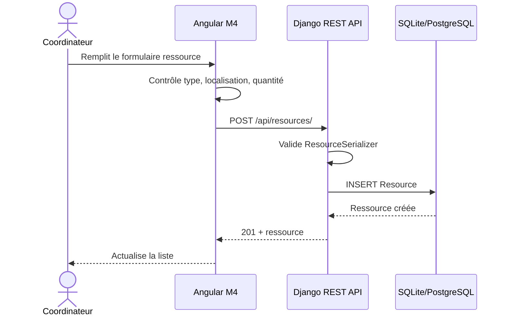

# Sprint 1 — Module M4

## Périmètre

Le sprint implémente les CRUD prioritaires HUM_001 à HUM_004 du cahier des charges : bénévoles, ressources/offres, refuges et personnes disparues. L’IA de matching et la mobilisation sont planifiées pour un sprint métier ultérieur.

## Sprint backlog

| ID | User story | Critères d’acceptation | Priorité |
|---|---|---|---|
| HUM-001 | En tant que coordinateur, je crée un bénévole avec compétences, zone et disponibilité. | Les champs obligatoires sont contrôlés et la fiche apparaît dans la liste. | Haute |
| HUM-002 | En tant que coordinateur, je gère une ressource et sa quantité. | Type, localisation et quantité sont enregistrés; quantité positive obligatoire. | Haute |
| HUM-003 | En tant que gestionnaire, je gère un refuge. | Capacité, occupation et places disponibles sont affichées; occupation ≤ capacité. | Haute |
| HUM-004 | En tant qu’opérateur, je déclare et clôture une personne disparue. | Le cycle Missing → Possible Match → Found → Closed est conservé. | Haute |
| TECH-001 | En tant qu’équipe, j’utilise une API REST documentée par routes. | Les quatre endpoints supportent GET, POST, PUT et DELETE. | Haute |
| TECH-002 | En tant qu’utilisateur, je reçois un retour d’erreur lisible. | Les erreurs de validation sont affichées sans perdre les données saisies. | Haute |

## Diagramme de séquence — créer une ressource

## Burndown prévu

| Jour | Travail restant (points) |
|---|---:|
| J1 | 20 |
| J2 | 17 |
| J3 | 13 |
| J4 | 8 |
| J5 | 4 |
| J6 | 0 |

## Démonstration

1. Démarrer l’API puis le frontend.
2. Créer un bénévole, une ressource et un refuge.
3. Modifier puis supprimer une fiche.
4. Saisir une quantité négative ou une occupation supérieure à la capacité pour montrer les contrôles.
5. Vérifier l’actualisation de la liste après chaque opération.
